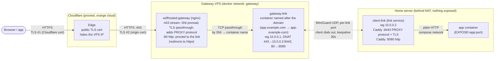
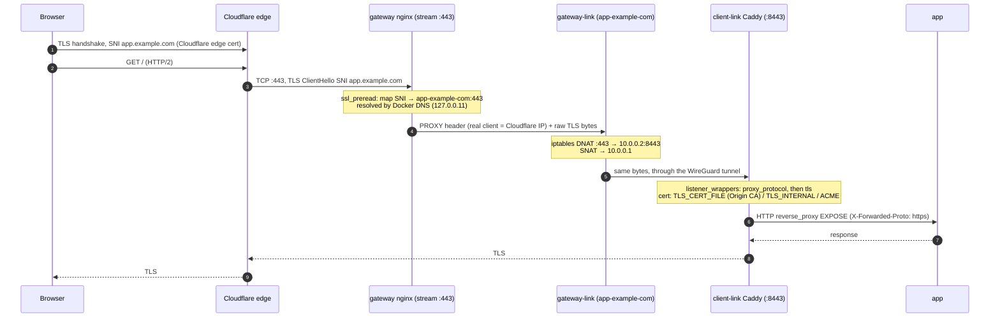
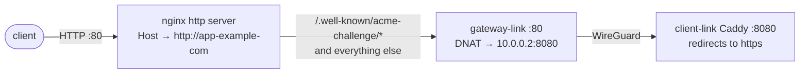
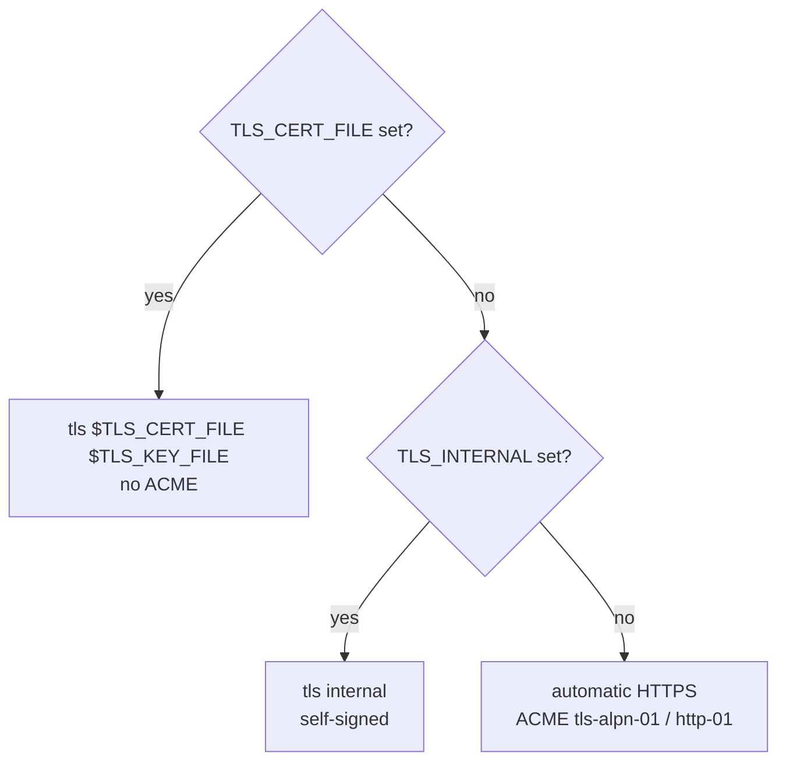
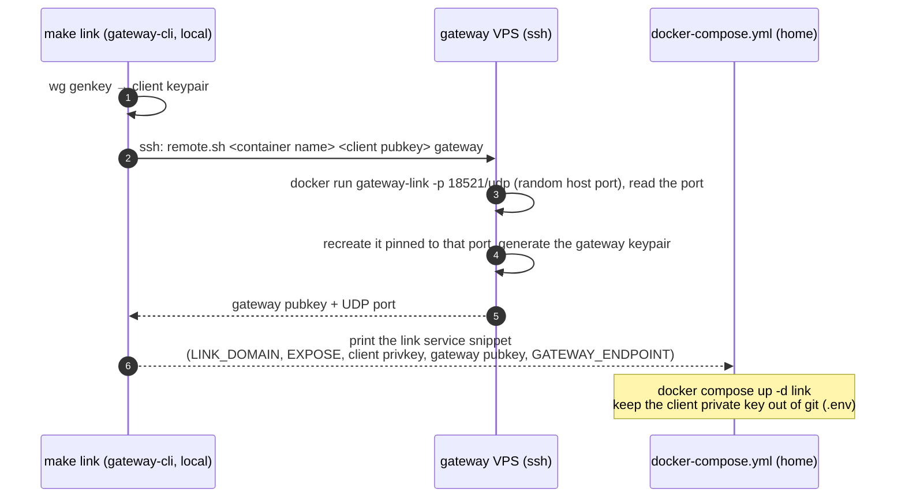

# Architecture

How a request travels from the internet to a self-hosted app, with the gateway VPS in front of Cloudflare's proxy
and the app at home behind NAT. Diagrams are [Mermaid](https://mermaid.js.org/) and render on GitHub.

## Overview

TLS is terminated twice: Cloudflare terminates the browser's TLS, and opens a new TLS connection to the origin. The
gateway never decrypts anything on 443: nginx only reads the SNI to pick the gateway-link container, so the origin
TLS session ends in the home server's Caddy.

## One HTTPS request

## Port 80

Port 80 has no auth of its own: 443 is TLS passthrough, so a gateway login could only ever cover plain `http://`,
which the link redirects to https anyway. Turn on Cloudflare's "Always Use HTTPS" so clients never reach it.

## TLS on the link (client-link)

Cloudflare's proxy terminates TLS, so ACME's `tls-alpn-01` challenge can't reach the link, and `http-01` only works if
port 80 passes through untouched. A proxied link therefore needs a cert that doesn't depend on ACME.

| Mode | env | Cert | Cloudflare SSL mode | Survives restarts behind the proxy |
|---|---|---|---|---|
| ACME (default) | none | Let's Encrypt (ZeroSSL fallback) | Full (strict) | only while DNS-only (grey cloud) |
| Internal | `TLS_INTERNAL: true` | self-signed by Caddy | Full (not strict) | yes, but Cloudflare can't verify the origin |
| Mounted cert | `TLS_CERT_FILE`, `TLS_KEY_FILE` | e.g. Cloudflare Origin CA (wildcard, 15 years) | Full (strict) | yes |

## Creating a link

- The SSH login uses the key given as `SSH_KEY` (mounted read-only for that run, never in the image) or the
  ssh-agent, and the port from `GATEWAY=host:port`. `~/.ssh/known_hosts` is mounted so a changed gateway host key is
  rejected. This login only creates links, the tunnel's security comes from the per-link WireGuard keys. With
  `gateway-link-command` as the key's forced command, the key can't do anything else on the gateway.
- The host part of `GATEWAY_ENDPOINT` is the SSH target's address (or `GATEWAY_ENDPOINT_HOST`), not the DNS of the
  link's domain: behind Cloudflare that would be a Cloudflare IP, and WireGuard has to reach the VPS directly.

## Naming

The domain maps to a container name on the `gateway` network, the same way for the stream (443) and http (80)
servers:

| Domain | Container |
|---|---|
| `example.com` | `example-com` |
| `app.example.com` | `app-example-com` |
| `x.app.example.com` | `x-app-example-com` |

## Hardening behind Cloudflare

- Only allow Cloudflare's IP ranges on 80/443 of the VPS (in the `DOCKER-USER` chain, ufw doesn't apply to published
  docker ports). Otherwise anyone can reach the origin directly and scanners can tie the domains to the VPS IP.
- Use Origin CA certs on the links (not in Certificate Transparency logs) and SSL mode Full (strict).
- Keep SSH and the per-link WireGuard UDP ports open.
- `http://<domain>/test` on port 80 reveals the routing target, block it if that matters.
